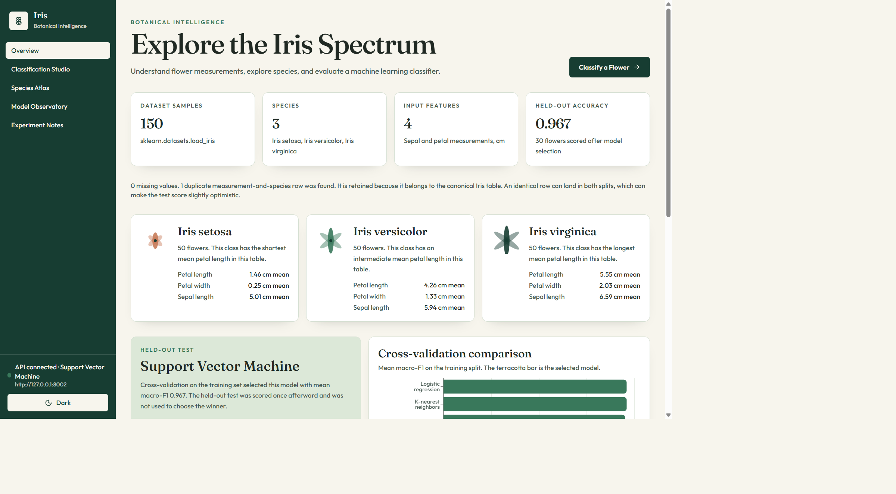
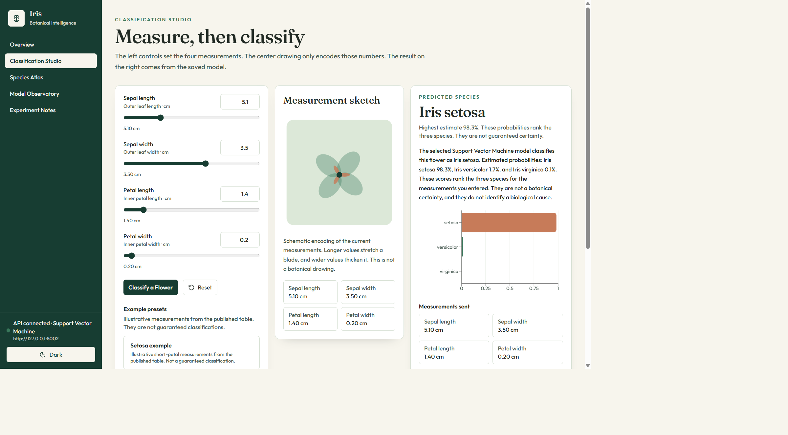
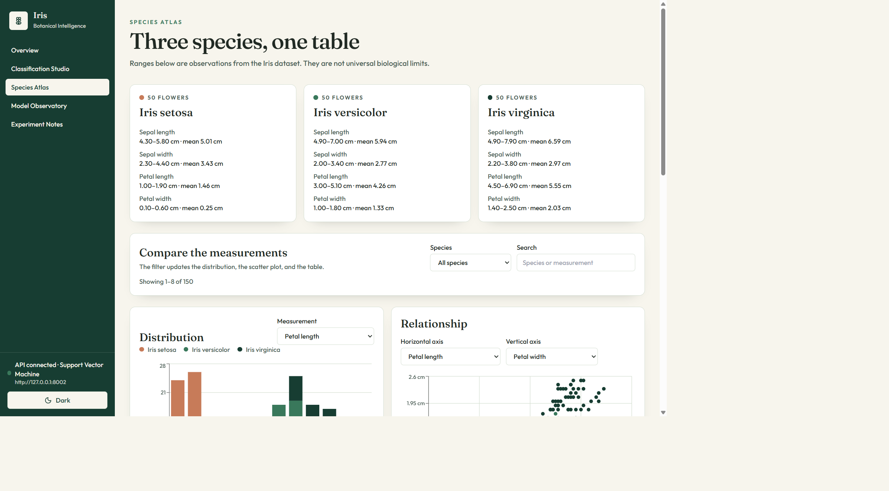
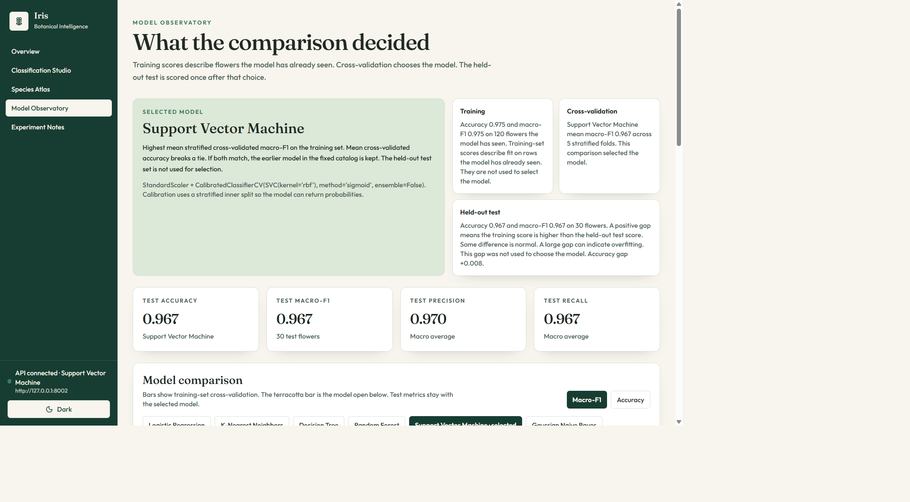
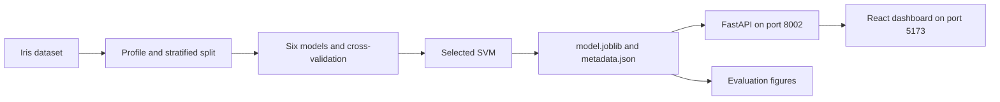

# Iris Flower Classification — Botanical Intelligence

A local machine-learning application that classifies an Iris flower from four measurements and explains how that decision was reached. The dashboard, FastAPI service, and saved scikit-learn model run on your machine. This repository does not include a public deployment.

The task is supervised classification. Each flower is described by sepal length, sepal width, petal length, and petal width. The model assigns one of three species: Iris setosa, Iris versicolor, or Iris virginica.

[Local setup](#local-setup) · [API](#api) · [Results](#results) · [Architecture](#architecture) · [Project structure](#project-structure)


## Screenshots

Captured from the running dashboard at `http://127.0.0.1:5173`, with the Iris API on port 8002.

<p>
  
</p>

Overview. Dataset size, species cards, and the cross-validation comparison for the saved training run.

<p>
  
</p>

Classification Studio. A live prediction from the saved support vector machine: Iris setosa, highest estimate 98.3%.

<p>
  
</p>

Species Atlas. Observed ranges and charts for all 150 flowers.

<p>
  
</p>

Model Observatory. Cross-validation selected the model. The held-out scores were computed once afterward.

## What it does

The Iris table is a small, balanced, fully labeled dataset, which makes the whole classification workflow easy to inspect: split, compare, select, evaluate, and predict. It is a teaching dataset, not evidence that the same model would work on new flowers, sensors, or species.

Four inputs, in centimeters:

- Sepal length
- Sepal width
- Petal length
- Petal width

Three outputs: Iris setosa, Iris versicolor, and Iris virginica, 50 flowers each.

The dashboard shows the dataset, a live classification with class probabilities, species comparisons, and the saved evaluation. Every score on those pages comes from `ml/artifacts/metadata.json` through the API.

## Features

- Compares six classifiers: logistic regression, k-nearest neighbors, a decision tree, a random forest, a support vector machine, and Gaussian naive Bayes.
- Uses a stratified 80/20 split and 5-fold stratified cross-validation on the training split only.
- Selects the winner by mean macro-F1, then mean accuracy.
- Scores that winner once on the 30-flower held-out test set.
- Classification Studio sends the four measurements to the saved model and charts the returned probabilities.
- Species Atlas filters and charts the published table.
- Model Observatory shows the confusion matrix, classification report, and permutation importance.
- FastAPI serves health, model info, analytics, single prediction, and batch prediction.
- React and TypeScript dashboard with light and dark themes.
- The five dashboard pages are loaded with `React.lazy` and `Suspense`.

## Technology stack

**Machine learning and data analysis.** Python 3.11 or newer, NumPy, pandas, scikit-learn, Matplotlib, Seaborn, and Joblib.

**Backend API.** FastAPI, Pydantic, and Uvicorn.

**Frontend and visualizations.** React 18, TypeScript, Vite, Tailwind CSS, Recharts, and Lucide.

**Testing and tooling.** pytest with FastAPI's TestClient, Vitest, and the TypeScript compiler. `httpx` is the TestClient transport.

## Architecture



Training writes one model and one metadata file under `ml/artifacts`. The API loads that model once at startup and serves predictions from it. Analytics responses are the saved evaluation, not a new training run. The dashboard calls `VITE_API_BASE_URL`, which is `http://127.0.0.1:8002`. Vite can also proxy a relative `/api` path to that port.

Port 8001 belongs to the separate Movie Review Sentiment Analysis application. This project does not use it.

## Dataset and method

The source is `sklearn.datasets.load_iris()`, the published Fisher Iris table: 150 rows, four measurements in centimeters, and 50 flowers of each species. The working table has six columns because it also keeps the numeric target and the species name. There are no missing values. One duplicate measurement-and-species row is retained because it belongs to the canonical table. An identical row can fall in both splits, which can make the test score slightly optimistic.

Random seed `42` is used for the split, cross-validation, trees, and permutation importance.

1. Load the table into pandas and profile shape, missing values, duplicates, class counts, statistics, and correlations.
2. Split 80/20 with `train_test_split`, `stratify=y`, and `random_state=42`: 120 training flowers and 30 test flowers, 40 and 10 of each species.
3. Put `StandardScaler` inside a pipeline for logistic regression, k-nearest neighbors, and the support vector machine. The scaler is fit on training rows only. The decision tree, random forest, and Gaussian naive Bayes use the raw centimeter values.
4. Score each model with 5-fold stratified cross-validation on the training set.
5. Select the highest mean macro-F1. Mean accuracy breaks a tie. The test set is not used for this choice.
6. Fit the winner on all 120 training flowers and score it once on the 30 test flowers.
7. Explain the winner with permutation importance on the test set after selection.

The test labels stay out of scaling, model comparison, and selection. That is how this pipeline avoids leakage. The support vector machine uses an RBF kernel. Probabilities come from `CalibratedClassifierCV` with sigmoid calibration on a stratified inner split, because the API needs `predict_proba`.

The fitted pipeline is stored in `ml/artifacts/model.joblib`. Feature order is sepal length, sepal width, petal length, petal width. The API loads that same pipeline, so inference uses the training preprocessing and the same column order.

## Results

These numbers are from `ml/artifacts/metadata.json`, produced by `python -m ml.src.train`. Cross-validation scores describe the training split. The held-out block is a separate, single evaluation of the selected model.

The saved held-out accuracy is `0.9666666666666667`. That is 96.67% of the 30 test flowers, and 0.967 when shown to three decimal places. The dashboard reads this value from the API. It is not a hardcoded display number.

| Model | CV macro-F1 | CV accuracy | Scaling | Selected |
| --- | ---: | ---: | --- | --- |
| Logistic Regression | 0.9580 ± 0.0299 | 0.9583 ± 0.0295 | yes | no |
| K-Nearest Neighbors | 0.9580 ± 0.0299 | 0.9583 ± 0.0295 | yes | no |
| Decision Tree | 0.9496 ± 0.0192 | 0.9500 ± 0.0186 | no | no |
| Random Forest | 0.9494 ± 0.0355 | 0.9500 ± 0.0349 | no | no |
| Support Vector Machine | 0.9665 ± 0.0187 | 0.9667 ± 0.0186 | yes | yes |
| Gaussian Naive Bayes | 0.9496 ± 0.0192 | 0.9500 ± 0.0186 | no | no |

Held-out test set, 30 flowers, selected support vector machine:

| Metric | Score |
| --- | ---: |
| Accuracy | 0.966667 |
| Precision, macro | 0.969697 |
| Recall, macro | 0.966667 |
| Macro-F1 | 0.966583 |

Confusion matrix, rows actual and columns predicted, in the order setosa, versicolor, virginica:

|  | Predicted setosa | Predicted versicolor | Predicted virginica |
| --- | ---: | ---: | ---: |
| Actual setosa | 10 | 0 | 0 |
| Actual versicolor | 0 | 9 | 1 |
| Actual virginica | 0 | 0 | 10 |

Per-class held-out scores: setosa precision 1.00, recall 1.00; versicolor precision 1.00, recall 0.90; virginica precision 0.909, recall 1.00. Training accuracy was 0.975 and training macro-F1 was 0.975. Those training scores were not used to choose the model. The accuracy gap is about 0.008.

Permutation importance is the drop in held-out macro-F1 when a feature is shuffled, computed after selection:

| Measurement | Mean macro-F1 drop | Share |
| --- | ---: | ---: |
| Petal width | 0.2837 | 49.9% |
| Petal length | 0.2288 | 40.2% |
| Sepal width | 0.0530 | 9.3% |
| Sepal length | 0.0033 | 0.6% |

Petal measurements account for 90.1% of the absolute importance in this run, and sepal measurements account for 9.9%. That describes the fitted model. It is not a causal claim about flower biology.

A strong score on 150 teaching rows does not establish real-world performance.

## Local setup

From PowerShell, after cloning:

```powershell
git clone <repository-url>
cd iris-flower-classification
py -3.11 -m venv .venv
.\.venv\Scripts\python.exe -m pip install -r requirements.txt
```

`backend/requirements.txt` points at the same list. One virtual environment covers training, the API, and tests. No API key is required.

Frontend:

```powershell
cd frontend
npm install
cd ..
```

Configuration is optional. Copy `.env.example` to `.env` to change the API host, port, log level, CORS origins, or artifact directory. Copy `frontend/.env.example` to `frontend/.env` to change `VITE_API_BASE_URL`. The committed examples already point at `127.0.0.1:8002`.

Train only when you want to regenerate the artifacts. The repository already includes the fitted model:

```powershell
.\.venv\Scripts\python.exe -m ml.src.train
```

`.\scripts\train.ps1` creates the virtual environment if needed, installs dependencies, and trains.

Start the Iris API:

```powershell
.\.venv\Scripts\python.exe -m uvicorn backend.app.main:app --host 127.0.0.1 --port 8002
```

`.\scripts\backend.ps1` does the same and adds `--reload`. The default port is 8002. Port 8001 is the Movie Review application, so this API does not bind there.

Start the dashboard in a second terminal:

```powershell
cd frontend
npm run dev
```

Open [http://127.0.0.1:5173](http://127.0.0.1:5173). Interactive API docs are at [http://127.0.0.1:8002/docs](http://127.0.0.1:8002/docs).

A single command-line prediction:

```powershell
.\.venv\Scripts\python.exe -m ml.src.predict --sepal-length 5.1 --sepal-width 3.5 --petal-length 1.4 --petal-width 0.2
```

Checks:

```powershell
.\.venv\Scripts\python.exe -m pytest
.\scripts\test.ps1
```

From `frontend`:

```powershell
npm test
npm run typecheck
npm run build
```

`npm run build` typechecks and writes `frontend/dist`. `npm run preview` serves that build on port 4173 and proxies `/api` to port 8002.

## API

Measurements must be finite numbers greater than 0 and at most 30 centimeters. Missing fields, non-numeric values, NaN, infinity, and extra fields return HTTP 422. If the model file is missing, prediction and analytics return HTTP 503. Health still returns HTTP 200 with `model_available: false`.

### `GET /api/health`

```powershell
curl.exe http://127.0.0.1:8002/api/health
```

```json
{
  "status": "ok",
  "model_available": true,
  "model_name": "Support Vector Machine",
  "version": "1.0.0",
  "message": "Model loaded."
}
```

### `GET /api/model-info`

Returns the selected model, feature names, class names, and held-out metrics from the saved evaluation.

```powershell
curl.exe http://127.0.0.1:8002/api/model-info
```

### `GET /api/analytics`

Returns the dataset profile, cross-validation table, test metrics, confusion matrix, classification report, feature importance, and the 150 flower records used by the dashboard.

```powershell
curl.exe http://127.0.0.1:8002/api/analytics
```

### `POST /api/predict`

`predicted_species` is the class with the highest probability. `probabilities` ranks all three species and sums to 1. Those scores are the model's estimates for the entered measurements, not botanical certainty.

```powershell
curl.exe -X POST http://127.0.0.1:8002/api/predict -H "Content-Type: application/json" -d "{\"sepal_length_cm\":5.1,\"sepal_width_cm\":3.5,\"petal_length_cm\":1.4,\"petal_width_cm\":0.2}"
```

The saved model returns Iris setosa for that example, with probabilities about 0.982623, 0.016572, and 0.000806.

### `POST /api/predict/batch`

Send 1 to 100 flowers:

```json
{
  "samples": [
    {
      "sepal_length_cm": 5.1,
      "sepal_width_cm": 3.5,
      "petal_length_cm": 1.4,
      "petal_width_cm": 0.2
    }
  ]
}
```

The response includes `count` and a `predictions` array. Each item has the same shape as a single prediction.

## Project structure

```text
backend/                 FastAPI application and API tests
frontend/                React dashboard, Vitest tests, and Vite config
ml/src/                  Training, evaluation, plots, and the prediction CLI
ml/artifacts/            model.joblib and metadata.json
ml/tests/                Dataset, split, and training tests
docs/screenshots/        Dashboard captures used in this README
reports/                 Evaluation summary and figures
scripts/                 Windows helpers for train, test, and the API
requirements.txt         Python dependencies
pytest.ini               Shared pytest path and test locations
```

Training figures:

- `reports/figures/pairplot.png`
- `reports/figures/feature_distributions.png`
- `reports/figures/correlation_heatmap.png`
- `reports/figures/model_comparison.png`
- `reports/figures/confusion_matrix.png`
- `reports/figures/feature_importance.png`

## Limitations

- The dataset has 150 rows from a teaching study. Held-out accuracy does not show how the model would behave on new populations.
- Predictions depend on this table, the seed-42 split, the fixed hyperparameters, and the selected support vector machine.
- One duplicate row is retained and can appear on both sides of the split.
- The test set has 30 flowers, so one mistake moves accuracy by about 3 percentage points.
- Feature importance and the nearest class average are descriptive, not causal.
- Hyperparameters were not tuned with a search.
- The application runs locally. Nothing in this repository deploys it to a public host.

## Possible next steps

- Add a calibration plot and show which test flower was misclassified.
- Compare probability quality, not only the hard classification.
- Record the duplicate row indexes so split overlap can be reported directly.
- Version saved models when the training procedure changes.
- Serve the API and dashboard on a host only after the evaluation story is still visible to users.
